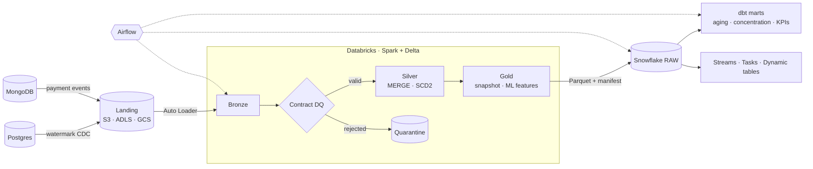

# Invoice Factoring Lakehouse: Databricks + Snowflake

A production-style data platform for an **invoice-factoring (receivables finance) company**. Source
data from Postgres and MongoDB flows through a **Databricks (Spark + Delta Lake)** medallion
pipeline into **Snowflake**, where **dbt** builds the BI marts. **Airflow** orchestrates the run, and
reconciliation plus data-quality gates keep the numbers trustworthy for analytics and machine learning.

> Portfolio project demonstrating senior data engineering: Snowflake, Databricks/Spark, SQL, Python,
> Airflow, dbt, AWS/Azure/GCP, Postgres, MongoDB, data contracts, testing and governance.



**Full design:** [docs/architecture.md](docs/architecture.md) (system context, container and
sequence diagrams, data model, DQ flow, runbook) · **Decisions:** [docs/adr/](docs/adr/README.md)

---

## Quickstart (local, no cloud account needed)

Requirements: Python 3.10+, Java 17. Delta jars are downloaded on first run.

```bash
make setup        # venv + package + dev tools
make demo         # generate 2 days of data → bronze → silver → gold → Snowflake export, then a report
make test         # pytest: unit + end-to-end
make bdd          # behave: business scenarios (Gherkin)
make lint         # ruff + sqlfluff (Snowflake dialect)
make dbt-parse    # validate the dbt project offline
make snowflake-dry-run   # print the COPY/MERGE/reconcile SQL for a load
make up           # optional: Postgres + MongoDB sources for the extraction demo
```

`make demo` ends with a report like this (actual output, as of 2026-11-01):

```
=== Portfolio aging as of 2026-11-01 ===
|aging_bucket|invoices|outstanding|
|CURRENT     |276     |8295762.98 |
|1-30        |34      |780558.92  |
|31-60       |7       |211467.05  |
|90+         |2       |43478.01   |

=== Debtor concentration breaches (> 25% of a client's open book) ===
|client_id|debtor_id|exp      |client_exp|share|
|C0006    |D0057    |105052.69|407422.87 |0.258|
|C0011    |D0001    |131320.72|515200.29 |0.255|
...
=== Data-quality metrics ===
|batch_id|entity  |total|rejected|rule_failures                                                                    |
|day1    |clients |21   |1       |{client_name_not_null -> 1}                                                      |
|day1    |invoices|800  |9       |{debtor_id_not_null -> 3, currency_accepted -> 2, debtor_id_fk_debtors -> 2, ...}|
|day1    |payments|518  |3       |{method_accepted -> 1, invoice_id_fk_invoices -> 2}                              |
```

Day 2 also logs `stale_skipped: 2` (late CDC events ignored by the MERGE guard) and
`inserted: 6, closed: 5` on the SCD2 debtor merge.

The synthetic data carries **planted defects** (negative amounts, null and orphan foreign keys, bad
enums, duplicate replays, stale late-arriving CDC, unchanged debtor replays, rating changes). The
tests assert that the pipeline handles each one exactly.

---

## What it demonstrates

| Area | Where | Highlights |
|---|---|---|
| **Spark / Databricks** | `src/factoring_lakehouse/{bronze,silver,gold}.py` | Explicit schemas, Auto Loader, window dedupe, **atomic SCD2 MERGE**, `updated_at`-guarded upserts, point-in-time features, dynamic partition overwrite |
| **Databricks deploy** | `databricks/` | Asset Bundle (dev/prod), Photon job cluster on spot, wheel tasks, **Delta Live Tables** variant with `apply_changes`, OPTIMIZE/ZORDER/VACUUM |
| **Data contracts and DQ** | `contracts.py`, `quality.py` | pydantic → Spark schema + rules; quarantine with reasons; reject-rate gates; DQ metrics |
| **Snowflake** | `snowflake/sql/` | RBAC hierarchy, per-workload warehouses, resource monitor, storage integration, Snowpipe, **streams + tasks**, **dynamic table**, tag-based masking, row-access policy, access-history audit |
| **Snowflake loading** | `snowflake_io/loader.py` | Folder-scoped COPY, transactional MERGE / partition replace, **manifest reconciliation** |
| **dbt** | `dbt/` | Sources with freshness, staging → incremental marts (aging, concentration, DSO/dilution KPIs), SCD2 dimension, generic and singular tests |
| **SQL** | `snowflake/sql`, `dbt/models` | Window functions, QUALIFY, MERGE, point-in-time joins, linted with sqlfluff |
| **Airflow** | `airflow/dags/` | TaskGroups, deferrable Databricks operator, ShortCircuit reconcile gate, retries/SLA/alerts, Datasets, backfill-safe |
| **Sources** | `ingestion/`, `docker/` | Postgres watermark CDC (server-side cursor, lookback overlap), MongoDB events (BSON normalisation, contract validation), atomic file writes |
| **Cloud / IaC** | `infra/terraform/` | S3 (encryption, lifecycle, public-access block), IAM trust for the Snowflake storage integration, Snowflake objects; Azure/GCS variants documented |
| **Testing** | `tests/` | pytest unit + e2e on local Spark/Delta, **behave BDD** features, DAG integrity |
| **CI** | `.github/workflows/ci.yml` | ruff, sqlfluff, pytest, behave, dbt parse, Airflow DAG import, terraform validate |

## Repository layout

```
conf/                  pipeline config (local + Databricks)
src/factoring_lakehouse/
  contracts.py         pydantic data contracts → Spark schemas + DQ rules
  datagen.py           deterministic synthetic data with planted defects + manifest
  bronze.py            landing → bronze (batch or Auto Loader)
  quality.py           rules engine, quarantine, thresholds, metrics
  silver.py            dedupe + MERGE strategies (Type 1, SCD2, insert-only)
  gold.py              portfolio_snapshot, debtor_features (point-in-time)
  pipeline.py          CLI / job entrypoint, Snowflake export + manifest, report
  ingestion/           Postgres + MongoDB incremental extractors, watermarks
  snowflake_io/        COPY/MERGE loader + reconciliation
databricks/            Asset Bundle, job, DLT pipeline, maintenance notebook
snowflake/sql/         account setup → integration → raw/Snowpipe → streams/tasks → dynamic tables → governance
dbt/                   staging, marts, ml models + tests
airflow/dags/          factoring_lakehouse_daily
infra/terraform/       AWS + Snowflake IaC
tests/unit, tests/features (behave), tests/test_pipeline_e2e.py
docs/architecture.md, docs/adr/
ref_docs/              project ideas, initial design, implementation plan
```

## Honest scope notes

- Everything under `src/` runs and is tested locally. Snowflake, Databricks, Airflow and Terraform
  artefacts are deploy-ready but were validated statically (sqlfluff, `dbt parse`, DAG import test,
  dry-run SQL); running them needs accounts and credentials.
- Gold snapshots use the current silver state, so backfilling a past `as_of_date` uses today's
  invoice status (debtor attributes are point-in-time through SCD2). A full historical rebuild would
  use Delta time travel (`VERSION AS OF`) per date.
- Next steps: streaming payments with Structured Streaming end-to-end, MLflow training on
  `debtor_features`, and Iceberg/Unity Catalog interoperability to remove the export copy (ADR-0005).
