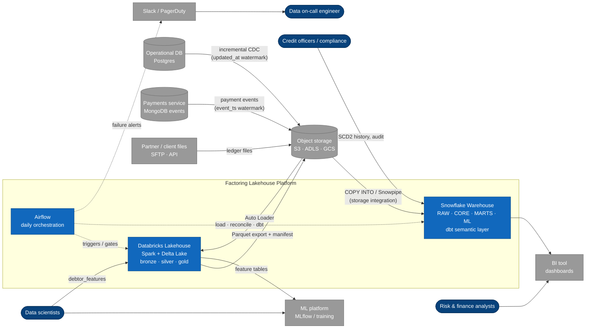
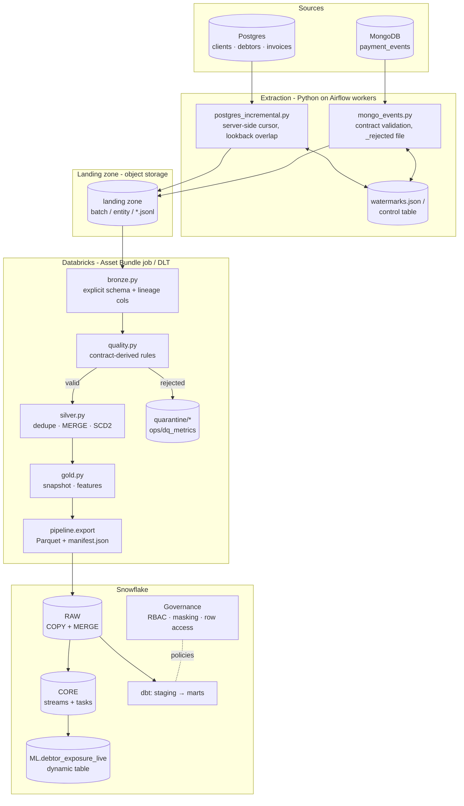
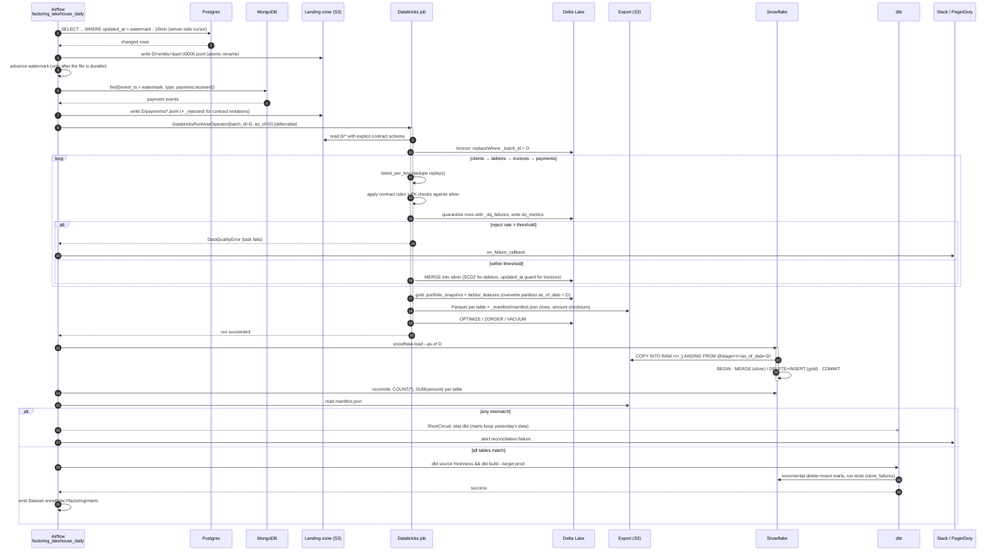
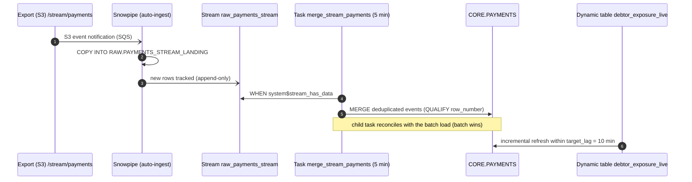
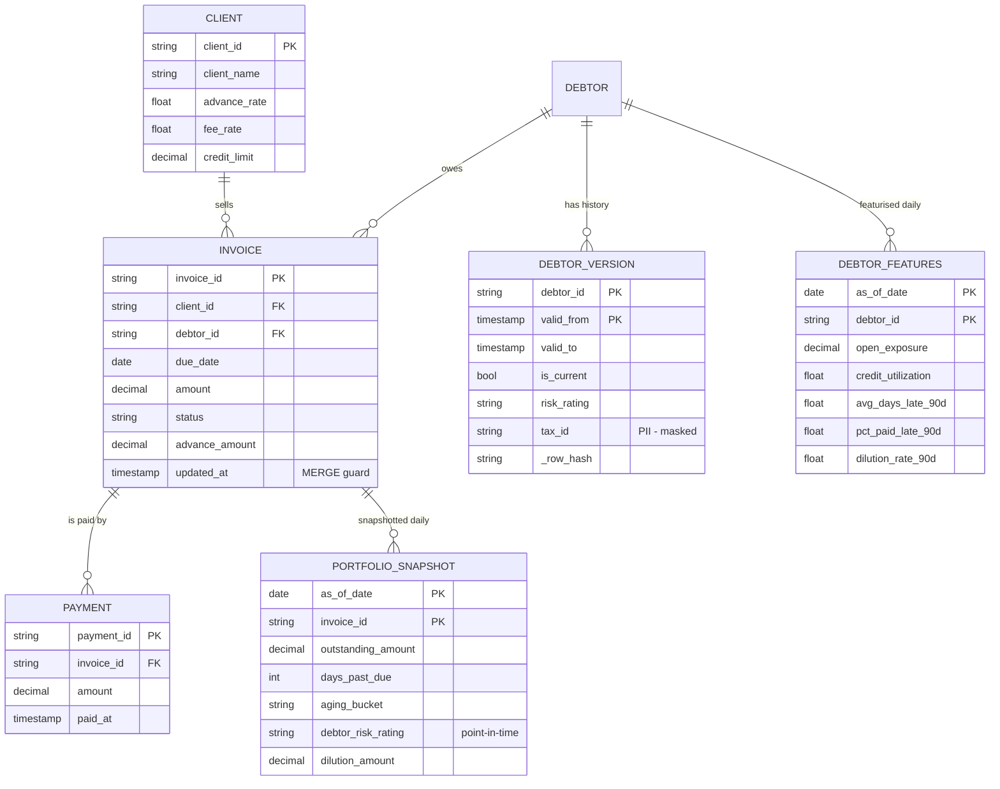
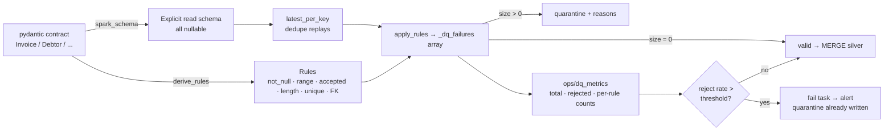

# Architecture: Invoice Factoring Lakehouse

> Status: implemented (local demo, tests and deploy-ready configs) · Owner: data platform · Last updated: 2026-11-06

This document covers what the system does, who it serves, how data moves through it, and why it is
built this way. The decisions behind it are in the [Architecture Decision Records](adr/README.md).

---

## 1. Business context

A **factoring company** buys the unpaid invoices of its **clients** (small and mid-size sellers) that
are owed by **debtors** (their customers). It advances most of the face value right away (the
*advance rate*, e.g. 85%), holds back the rest as a *reserve*, collects from the debtor, then
releases the reserve minus its *fee*.

The business runs on a few questions that need reliable, timely data:

| Question | Metric | Consumer |
|---|---|---|
| How much money is out, and how late is it? | Aging buckets, days past due, DSO | Risk / finance (BI) |
| Is a client over-exposed to one buyer? | Debtor concentration share (> 25% is a breach) | Credit committee |
| How much invoice value is lost? | Dilution rate (short pays, cancellations) | Underwriting |
| Will this debtor pay late? | Point-in-time debtor features | Data science (ML) |
| Can we prove what we knew on a given date? | SCD2 history, time travel, quarantine audit | Compliance |

---

## 2. System context (C4 level 1)

### Containers (C4 level 2)

---

## 3. Daily run: sequence

The happy path for logical date `D`. Each arrow is idempotent, so a retry or backfill of `D`
converges to the same state.

### Near-real-time payment path (parallel to the batch)

---

## 4. Data model

### Layers and load patterns

| Layer | Table | Grain | Write pattern | Idempotency |
|---|---|---|---|---|
| Bronze | `bronze/<entity>` | raw record | append, partitioned by `_batch_id` | `replaceWhere _batch_id = D` |
| Quarantine | `quarantine/<entity>` | rejected record + `_dq_failures[]` | partitioned by `_batch_id` | `replaceWhere` |
| Silver | `clients` | client | Type 1 MERGE, newest `updated_at` wins | MERGE |
| Silver | `debtors` | debtor version | **SCD2** staged-union MERGE, row hash | unchanged hash = no-op |
| Silver | `invoices` | invoice | MERGE guarded by `s.updated_at > t.updated_at` | stale/replayed events skipped |
| Silver | `payments` | payment | insert-only MERGE | duplicates ignored |
| Gold | `portfolio_snapshot` | invoice × as_of_date | dynamic partition overwrite | recompute = same partition |
| Gold | `debtor_features` | debtor × as_of_date | dynamic partition overwrite | point-in-time, no leakage |
| Snowflake RAW | 1:1 with exports | same | MERGE / DELETE+INSERT, one transaction | reconciled vs manifest |
| Snowflake MARTS | aging, concentration, KPIs | as_of × client (× debtor) | dbt incremental delete+insert | rerun replaces dates |

---

## 5. Data quality

Guarantees, each covered by tests:

1. **Nothing is dropped silently.** Every rejected row is in quarantine with every rule it broke.
2. **Fail loud.** If more than the configured share of a batch is bad, the batch fails *after*
   writing quarantine, so stewards can see why.
3. **Replays are harmless.** Exact duplicates collapse, stale CDC events cannot roll state back, and
   unchanged debtor rows create no SCD2 versions.
4. **Warehouse matches lake.** Row counts and amount checksums are reconciled before dbt publishes.
5. **Marts are tested.** dbt generic and singular tests cover uniqueness, relationships, concentration
   shares summing to 1, outstanding within face value, and one current SCD2 version per debtor.

---

## 6. Deployment view

| Concern | Choice | Where |
|---|---|---|
| Compute (lake) | Databricks job clusters, Photon, spot with fallback, autoscale 1–6 | `databricks/resources/factoring_job.yml` |
| Alternative | Delta Live Tables (serverless) with `apply_changes` | `databricks/dlt/factoring_dlt.py` |
| Packaging | Python wheel with entry points, Databricks Asset Bundle `dev`/`prod` | `pyproject.toml`, `databricks/databricks.yml` |
| Warehouse | Separate load / transform / BI warehouses, resource monitor | `snowflake/sql/00_account_setup.sql`, Terraform |
| Storage access | Storage integration + IAM role (no keys) | `snowflake/sql/01_*`, `infra/terraform/main.tf` |
| Orchestration | Airflow, deferrable Databricks operator, ShortCircuit reconcile gate | `airflow/dags/` |
| Secrets | Airflow secrets backend; Snowflake key-pair auth | DAG docstring, `dbt/profiles.example.yml` |
| CI | ruff, sqlfluff, pytest (Spark + Delta), behave, dbt parse, DAG integrity, terraform validate | `.github/workflows/ci.yml` |

### Multi-cloud notes

The pipeline code depends only on URIs and the Spark/Delta APIs. Moving clouds changes configuration,
not code:

- **AWS:** `s3://`, storage integration `STORAGE_PROVIDER='S3'`, IAM role trust.
- **Azure:** `abfss://`, `STORAGE_PROVIDER='AZURE'` with tenant consent, Databricks on Azure, ADF or Airflow.
- **GCP:** `gs://`, `STORAGE_PROVIDER='GCS'` service account, Dataproc/Databricks on GCP, Cloud Composer (Airflow).

---

## 7. Operational runbook (short)

| Symptom | Likely cause | Action |
|---|---|---|
| `DataQualityError: invoices reject rate …` | Source regression | Query `quarantine/invoices` for the batch and group by `_dq_failures`; fix the source; rerun the DAG for `D` |
| Reconcile gate skipped dbt | Partial COPY, or the export overwritten mid-load | Rerun `snowflake_load` then the gate for `D` (MERGE is idempotent) |
| Concentration report empty | Gold partition missing | Check the `gold` task for `D`; `pipeline --layer gold --as-of D` |
| Snowpipe lag | SQS notification misconfigured | `select system$pipe_status('raw.payments_pipe')` |
| Cost spike | Warehouse not suspending / BI concurrency | Check the resource monitor; `warehouse_load_history` |

---

## 8. Testing strategy

| Level | Tooling | What it proves | Location |
|---|---|---|---|
| Unit | pytest + local Spark/Delta | Contracts, rules, SCD2/upsert merges, aging, features, SQL generation, extractors | `tests/unit/` |
| End-to-end | pytest | Two days through every layer: quarantine matches planted defects, idempotent rerun, manifest | `tests/test_pipeline_e2e.py` |
| Behaviour (BDD) | behave (Gherkin) | Business-readable acceptance criteria: quarantine, SCD2, late data, aging | `tests/features/` |
| Static | ruff, sqlfluff, dbt parse, terraform validate, DAG integrity | Code and config correctness without cloud accounts | CI |
